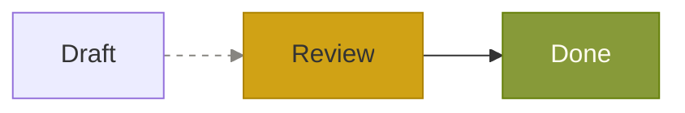
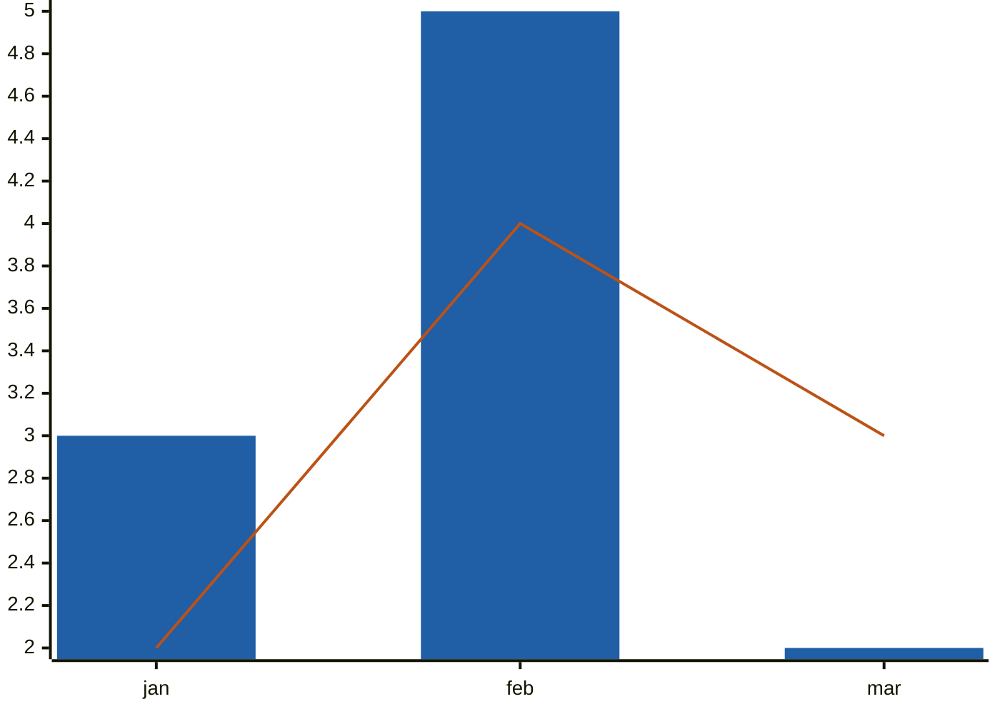

Pele uses CSS variables for colors and fonts, with class names for styling individual elements.

Switch between light and dark colors without re-rendering the diagram.

## Variables

| Variable | Default | Used for |
| --- | --- | --- |
| `--pele-bg` | `#ffffff` | Backgrounds |
| `--pele-fg` | `#1f1f1f` | Text |
| `--pele-fg-on-light` | `#1f1f1f` | Text on light fills set in the source |
| `--pele-fg-on-dark` | `#ffffff` | Text on dark fills set in the source |
| `--pele-muted` | `#6e6e6e` | Secondary text |
| `--pele-line` | `#1f1f1f` | Edges and arrowheads |
| `--pele-surface` | `#f3f3f3` | Node fill |
| `--pele-surface-alt` | `#e6e6e6` | Subgraph fill |
| `--pele-border` | `#8a8a8a` | Node and subgraph borders |
| `--pele-accent` | `#5b7bd5` | Highlights |
| `--pele-critical` | `#e45756` | Critical tasks in a Gantt chart, high priorities in a kanban |
| `--pele-error` | `#e45756` | Errors that [`mount()`](/api#mount) shows |
| `--pele-font` | Measured font | Label font. See [Fonts](#fonts) |
| `--pele-font-mono` | Measured font | Monospace labels |
| `--pele-title-weight` | `bold` | Diagram title |
| `--pele-heading-weight` | `bold` | Headings inside a diagram, such as class names and section labels |
| `--pele-bold-weight` | `bold` | Bold text in labels |
| `--pele-radius` | `4px` | Corner radius of rounded shapes |
| `--pele-block-edge-routing` | `orthogonal` | Block connection routing when using `mount()`. See [Block edge routing](#block-edge-routing). |

### Series colors

Charts and color-coded categories use `--pele-series-1` through `--pele-series-8`. Colors repeat after the eighth category.

| Variable | Default |
| --- | --- |
| `--pele-series-1` | `#4c78a8` |
| `--pele-series-2` | `#f58518` |
| `--pele-series-3` | `#54a24b` |
| `--pele-series-4` | `#e45756` |
| `--pele-series-5` | `#72b7b2` |
| `--pele-series-6` | `#eeca3b` |
| `--pele-series-7` | `#b279a2` |
| `--pele-series-8` | `#9d755d` |

For example, pie charts use a color for each slice, and git graphs use a color for each branch. Some shapes use `--pele-bg` for their text, so choose series colors that contrast with it.

## Setting variables

Set the variables on the root `<svg>` or on any element that contains it. The root of every diagram has the class `pele`.

```css
.pele {
  --pele-bg: #fffcf0;
  --pele-fg: #100f0f;
  --pele-muted: #6f6e69;
  --pele-line: #100f0f;
  --pele-surface: #f2f0e5;
  --pele-surface-alt: #e6e4d9;
  --pele-border: #cecdc3;
  --pele-accent: #205ea6;
  --pele-critical: #af3029;
}

@media (prefers-color-scheme: dark) {
  .pele {
    --pele-bg: #100f0f;
    --pele-fg: #cecdc3;
    --pele-muted: #878580;
    --pele-line: #cecdc3;
    --pele-surface: #1c1b1a;
    --pele-surface-alt: #282726;
    --pele-border: #403e3c;
    --pele-accent: #4385be;
    --pele-critical: #d14d41;
  }
}
```

### Fonts

Pele measures labels to size nodes, so it needs the font before rendering.

[`mount()`](/api#mount) reads `--pele-font` and `--pele-font-mono` from CSS. Without these variables, it uses the container font for regular text and `monospace` for monospace text.

```css
.diagram {
  --pele-font: var(--font-text);
  --pele-font-mono: var(--font-monospace);
}
```

Call `refresh()` after changing fonts so Pele can measure the labels again. `mount()` also redraws after pending web fonts load.

With [`render()`](/api#render), pass the font through `fontFamily`:

```ts
const fontFamily = getComputedStyle(container).fontFamily;
container.innerHTML = render(source, { fontFamily }).svg;
```

If you also set `--pele-font` in CSS, use the same font so the labels fit their measured size.

To draw part of a diagram in the monospace font, list it in [`monospace`](/api#renderoptions) instead of styling it with CSS alone, so Pele measures it in that font and makes room for it. Text with a `font-family` set by `style` or `classDef` keeps that font.

```ts
render(source, { monospace: ['members'] });
```

| Part | Text |
| --- | --- |
| `members` | Attributes and methods in class diagrams, styled by `.pele-member` |
| `attributes` | Attribute types, names and keys in ER diagrams, styled by `.pele-er-type`, `.pele-er-name` and `.pele-er-keys` |
| `files` | File and directory names in tree view diagrams, styled by `.pele-label` inside `.pele-tree-file` and `.pele-tree-dir` |
| `messages` | Message text on arrows in sequence diagrams, styled by `.pele-edge-label` |

## Block edge routing

When diagrams are rendered through [`mount()`](/api#mount), set `--pele-block-edge-routing` to `straight` to connect block outlines with direct lines:

```css
.straight-blocks {
  --pele-block-edge-routing: straight;
}
```

The variable inherits from the diagram's ancestors, so a class on a note can control all block diagrams inside it. Other diagram types are unaffected. `orthogonal`, an unset variable, or an invalid value preserves the existing router. Self-connections retain their loops.

Use `prefer-straight` for direct connections that fall back to a bend when the visible line would be too short after allowing for arrowheads, or when a bend crosses fewer blocks:

```css
.straight-blocks {
  --pele-block-edge-routing: prefer-straight;
}
```

The fallback compares the two L-shaped routes. It chooses fewer block crossings first, then less shared line. Bends account for straight connections and other fixed routes regardless of statement order, as well as bends chosen earlier. Simple crossings between arrows do not count as shared line. This is a local preference, not a guarantee that every overlap or block crossing can be avoided. The blocks keep their grid positions. As with the default router, obstacle checks are skipped for very large diagrams; shared-line checks also have a work limit.

For Obsidian, save the CSS above as `.obsidian/snippets/straight-blocks.css` in the vault and enable it under **Settings → Appearance → CSS snippets**. Add this property at the top of a note, outside its Mermaid code blocks:

```yaml
---
cssclasses:
  - straight-blocks
---
```

Keep the `block-beta` diagram source unchanged. This requires an Obsidian integration that uses this version of Pele's `mount()` API. An integration using `render()` directly must read the CSS property and pass `block.edgeRouting` itself; installing a snippet alone does not add support to an older Obsidian release.

An explicit `block.edgeRouting` option overrides CSS. The DOM-free `render()` API only reads its options. After changing the snippet or note class, the host should call the mounted diagram's `refresh()` method; re-rendering the note also applies the setting.

## Classes

Elements in the SVG have class names. Use them to style one kind of element without changing a variable.

| Class | Element |
| --- | --- |
| `pele` | The root `<svg>` of every diagram |
| `pele-flowchart` | The root `<svg>` of a flowchart |
| `pele-title` | The diagram title |
| `pele-node` | The group that holds a node's shape and label |
| `pele-edge` | The group that holds an edge's line and markers |
| `pele-edge-label` | The label on an edge |
| `pele-cluster` | A subgraph |
| `pele-cluster-label` | The title of a subgraph |
| `pele-label` | The text of a node label |
| `pele-marker` | An arrowhead or other edge marker |
| `pele-icon` | An icon |
| `pele-math` | A math expression |

Use `data-id` to target a node by its source id:

```css
.pele-node[data-id="start"] .pele-label {
  fill: var(--pele-accent);
}
```

## Styles in the diagram

Diagram styles can override theme colors. For example:



Colors set this way are fixed. They do not change with the theme.

A diagram can define fill colors with `style`, `classDef`, or a sequence `rect` or `box`. Labels on a fill automatically use whichever of `--pele-fg-on-light` and `--pele-fg-on-dark` contrasts more with it.

### Series palettes

Mermaid's palette theme variables replace the `--pele-series-*` colors in a diagram. Pele reads only the first eight colors of each palette:

| Diagram | Theme variables |
| --- | --- |
| XY chart | `xyChart.plotColorPalette`, a comma-separated list |
| Pie chart | `pie1` to `pie8` |
| Git graph | `git0` to `git7` |
| Timeline, radar, treemap | `cScale0` to `cScale7` |
| Mindmap | `cScale1` to `cScale8` |
| Venn diagram | `venn1` to `venn8` |



Palette colors are fixed, like other styles in the diagram. They don't change with the theme. To follow the theme, use a Pele CSS variable such as `var(--pele-accent)` as a palette color. Only `--pele-*` variables work. Labels on a palette color use whichever of `--pele-fg-on-light` and `--pele-fg-on-dark` contrasts more with it. Other `themeVariables` colors don't apply.
